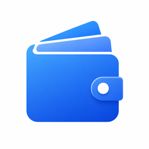
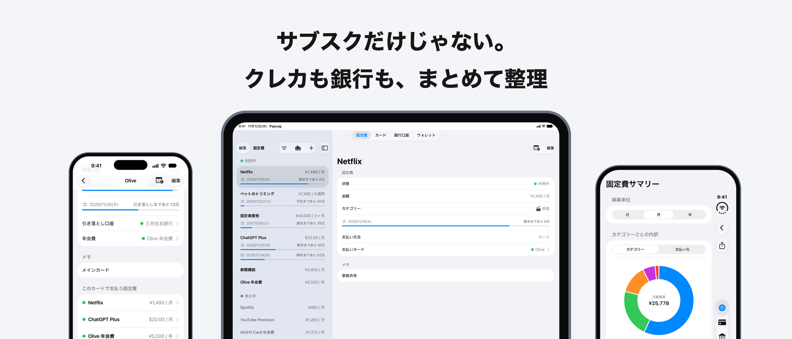
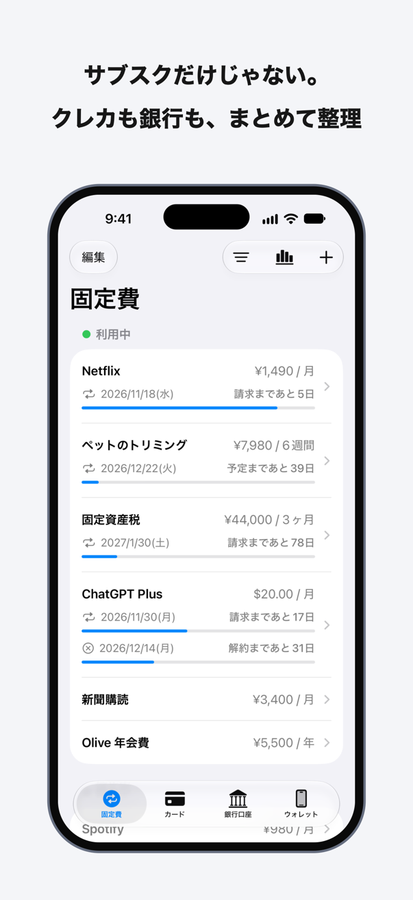
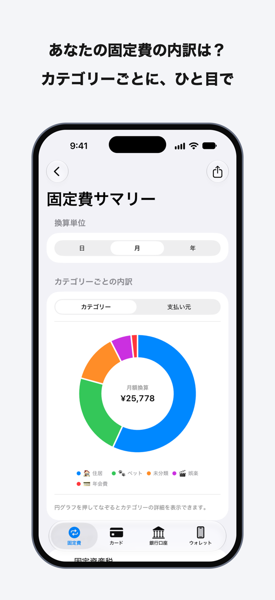
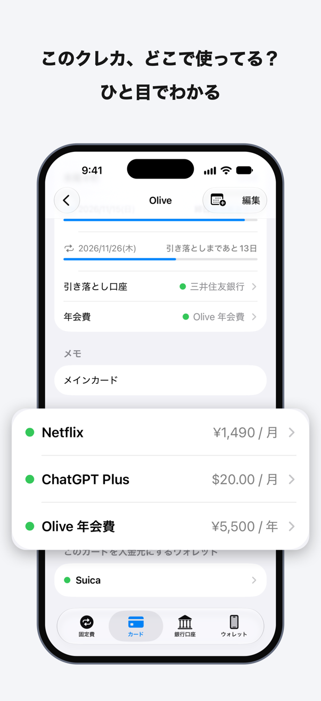
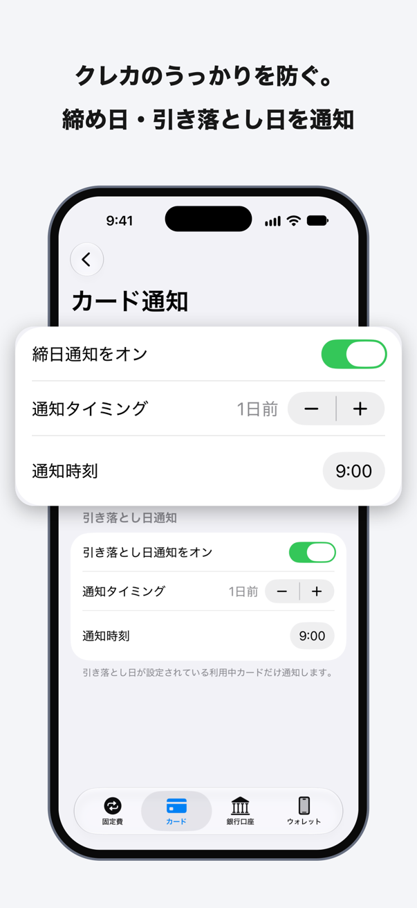
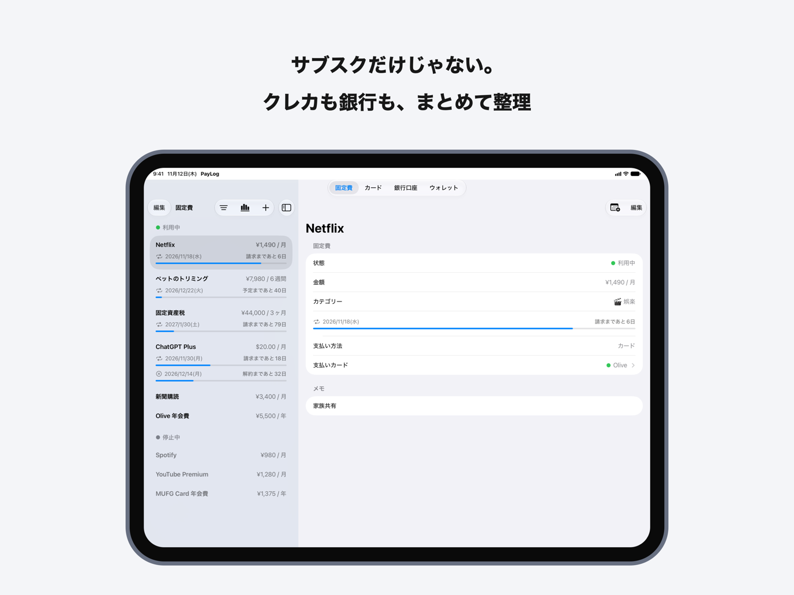

<div align="center">
  
  <h1>PayLog</h1>
  <p>サブスク・クレジットカード・銀行口座などの支払い情報を、まとめて整理・記録できる iOS アプリ</p>
  <a href="https://apps.apple.com/jp/app/paylog-%E6%94%AF%E6%89%95%E3%81%84%E6%83%85%E5%A0%B1%E3%81%AE%E6%95%B4%E7%90%86/id6763954131">
    
  </a>
</div>

<br>



## できること

- **固定費をまとめて管理** — サブスクや年会費を、好きな通貨と支払い周期で記録。次の請求日までの日数もひと目でわかります
- **支払い方法とひもづけ** — どの固定費をどのカード・口座・ウォレットで払っているかをたどれます
- **内訳を分析** — カテゴリーごと・支払い元ごとの内訳をグラフで確認
- **カードの締め日・引き落とし日を通知** — うっかり残高不足を防ぎます
- **利用中・停止中・解約予定を記録** — 解約予定日が来たら自動で停止中に切り替わります
- **iCloud で自動同期** — ログイン不要。入力したデータは端末内と iCloud にだけ保存され、外部サーバーへは送信しません

<p align="center">
  
  
  
  
</p>

iPad と iPhone Duo の内側の画面では、一覧と詳細が左右に並びます。



## 使っている技術

| 分野 | 技術 |
| --- | --- |
| UI | SwiftUI（`NavigationSplitView` による、画面の広さに合わせた 1 列・2 列の切り替え） |
| データ | SwiftData + CloudKit（iCloud 同期） |
| グラフ | Swift Charts |
| 通知・カレンダー | UserNotifications、EventKit |
| そのほか | TipKit、StoreKit（評価の依頼） |
| 配信 | Xcode Cloud |

## 構成

```
PayLog/
├── App/          アプリの入口とタブ
├── Features/     固定費・カード・銀行口座・ウォレットの各画面
├── Shared/       共通のモデル・サービス・ビュー
└── Preview/      プレビューとスクリーンショット用のサンプルデータ
PayLogUITests/    App Store 用スクリーンショットを撮影する UI テスト
scripts/          スクリーンショットの撮影と合成
```

## ビルド

Xcode で `PayLog.xcodeproj` を開き、`PayLog` スキームを実行します。iOS 18.6 以降が対象です。

データが空のときは、一覧の「サンプルデータを入れる」から動作を試せます。

## App Store 用スクリーンショット

スクリーンショットは、撮影から完成画像の合成まで自動で作っています。

```bash
scripts/screenshots.sh
```

1. UI テストがサンプルデータ入りのアプリを操作し、iPhone・iPhone Duo・iPad のシミュレータで素材を撮影
2. Swift スクリプト（CoreGraphics）が、コピー・端末フレーム・注目箇所の拡大を重ねて完成画像に合成

完成画像は `screenshots/store/` に出力されます。

## プライバシー

PayLog は、入力されたデータを外部サーバーへ送信しません。詳しくは[アプリの紹介ページ](https://chiji.tech/paylog)をご覧ください。
